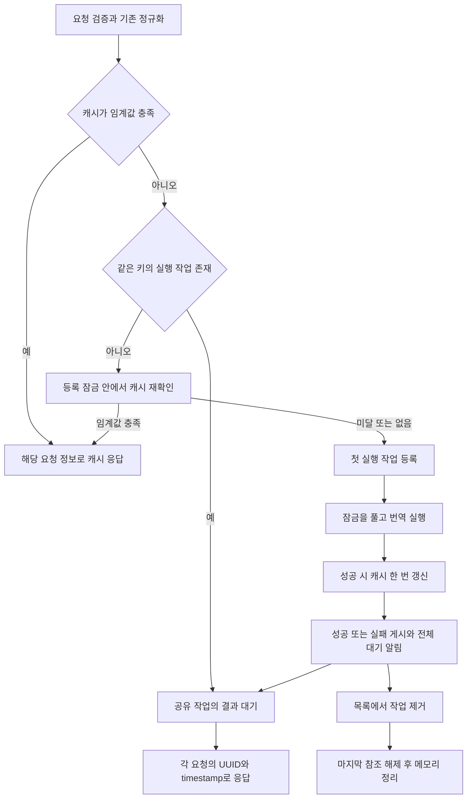

# 동일 번역 요청 병합 작업계획

작성일: 2026-11-03

상태: 구현 및 오프라인 검증 완료. 기존 번역 임계값 정책 유지.

같은 번역 요청이 동시에 들어오면 캐시를 먼저 확인한다. 캐시가 없거나 번역 임계값에 미달하면
첫 요청만 번역 엔진에 보내고 나머지는 대기시킨다. 번역이 끝나면 대기 요청 모두에 같은 결과를
전달하고 대기 목록을 정리한다. 실패한 경우에도 결과를 공유하고 대기를 해제한다.

**사용자 최종 지시: 기존 `TRANS_CACHE_THRESHOLD` 기준을 유지한다.**
한 번 저장된 번역을 무조건 재사용하는 방식으로 바꾸지 않는다.

## 1. 구현 전 동작과 변경 지점

아래 표는 구현 전 코드의 변경 근거다. 구현 결과와 검증은 12절에 기록한다.

| 지점 | 구현 전 동작 | 변경 내용 |
|---|---|---|
| `src/http_server.c:handle_translate()` | 입력 검증·언어 정규화·본문 정제 후 캐시 조회 | 같은 정규화 결과를 진행 중 요청 식별에도 사용 |
| 캐시 적중 | `cached->count >= cache_threshold`일 때만 즉시 응답 | 기존 기준 유지 |
| 캐시 미적중·임계값 미달 | 각 연결이 독립적으로 `openai_translate()` 호출 | 같은 키의 실행 요청 하나를 선정하고 후속 요청은 대기 |
| `src/trans_cache.c` | 개별 캐시 연산에 쓰기 잠금 사용 | 엔진 호출을 포함하는 요청 병합은 별도 관리자가 담당 |
| text·SQLite 중복 방지 | 중복 해시의 행 삽입 방지 | 엔진 중복 호출까지 막지는 못하므로 별도 조정 필요 |
| 응답 생성 | 요청별 `timestamp`, `uuid`와 번역문으로 JSON 생성 | 번역 결과만 공유하고 JSON은 요청별 생성 |
| MHD 실행 방식 | `MHD_USE_THREAD_PER_CONNECTION`, 연결 비활성 타임아웃 120초 | 우선 조건변수로 대기. 대기 수와 전체 작업 시간을 제한 |
| 서버 종료 | 시그널 핸들러가 `translation_server_stop()` 직접 호출 | 잠금·대기 해제·MHD 종료는 핸들러 밖에서 실행 |

병합은 normal과 codex exec·MCP 공통으로 `handle_translate()`와 `openai_translate()` 사이에 둔다.
캐시가 초기화되지 않아 사용할 수 없는 경우에도 진행 중 요청 병합은 동작하게 한다.

## 2. 같은 요청의 기준

키는 다음 값으로 정의한다.

```text
정규화된 from + 정규화된 to + ANSI·제어 문자를 제거한 text
```

- 기존 `trans_cache_calculate_hash()`의 SHA-256을 탐색 키로 사용한다. 해시가 같아도 원본 세 항목을 비교해 최종 동일성을 확인한다.
- `uuid`·`timestamp`·연결 정보는 키에서 제외한다. 서로 다른 UUID의 요청도 번역 내용이 같으면 합친다.
- `AUTO`와 `auto`, `zh-Hant`와 `zht` 등 기존 정규화 결과가 같으면 같은 키다.
- `from=auto`와 `from=eng`는 같은 본문이어도 별개다. 대상 언어나 정제 후 본문이 다르면 별개다.
- 공백·대소문자를 추가로 정규화하지 않는다. 기존 전처리 결과를 그대로 비교한다.
- 병합 범위는 서버 프로세스 하나다. 여러 인스턴스가 같은 DB를 쓰더라도 프로세스 사이의 실행은 합치지 않는다.

첫 요청은 같은 키를 관리 목록에 처음 등록한 요청을 뜻한다. 네트워크 도착 시각에 따른 엄격한 순서는 보장하지 않는다.

## 3. 임계값과 캐시 횟수 정책

| 조건 | 처리 |
|---|---|
| 캐시가 있고 `count >= TRANS_CACHE_THRESHOLD` | 기존처럼 캐시 응답. 번역 실행·대기 없음 |
| 캐시가 없거나 `count < TRANS_CACHE_THRESHOLD`, 같은 키 실행 중 | 해당 작업에 합류하고 결과 대기 |
| 캐시가 없거나 임계값 미달, 같은 키 실행 없음 | 캐시 재확인 후 새 실행 작업 생성 |
| 성공한 번역이 기존 저장 번역과 같음 | 실제 번역 실행 작업에서 `count` 한 번 증가 |
| 성공한 번역이 기존 저장 번역과 다름 | 기존 정책대로 번역문 교체, `count=1` |
| 최초 번역 성공 | 기존처럼 새 항목을 `count=1`로 저장 |
| 번역 실패 | 성공 캐시는 수정하지 않고 모든 합류 요청에 실패 전달 |

대기 요청은 같은 모델 결과를 공유한 것이므로 임계값 충족용 캐시 갱신을 따로 수행하지 않는다.
기존 캐시 적중 경로의 사용 횟수 증가는 유지한다. 별도의 대기 요청 수는 병합 관리자 통계로 기록한다.

예를 들어 임계값이 3이고 캐시가 없을 때 같은 요청 10개가 동시에 들어오면,
번역 작업은 하나이고 10개 모두 결과를 받지만 캐시 `count`는 1이다.
이후 두 번의 별도 작업에서도 같은 번역이 나오면 2, 3으로 증가하고 그다음 요청은 캐시에서 반환한다.
임계값이 1이면 최초 성공 이후부터 바로 캐시를 사용한다.

완료된 작업의 대기 목록을 정리한 뒤 새 요청이 들어왔는데 캐시가 여전히 임계값 미달이면,
새 번역 작업을 수행한다. 이것은 기존 임계값 정책에 따른 동작이다.

## 4. 요청 처리 순서



1. 기존 검증·정규화·전처리를 수행한다. 잘못된 요청은 대기 목록에 넣지 않는다.
2. 임계값을 충족한 캐시는 현재 경로로 즉시 반환한다.
3. 병합 관리자 잠금을 얻어 같은 키를 조회한다. 실행 중이면 참조와 대기 슬롯을 확보한다.
4. 같은 키가 없으면 잠금 안에서 캐시를 다시 확인한다. 최초 캐시 조회 이후 다른 작업이 완료된 경우의 중복 실행을 막는다.
5. 재확인도 미적중이면 완전히 초기화한 작업을 등록한다. 기존 캐시 스냅샷은 실행 요청만 소유한다.
6. 관리자 잠금을 풀고 엔진을 호출한다. 다른 키의 번역과 합류 처리는 계속 진행할 수 있다.
7. 성공하면 기존 비교·저장 정책으로 캐시를 한 번 갱신한다. 저장 실패가 번역 성공을 무효화하지는 않는다.
8. 결과·HTTP 상태·재시도 여부를 공유 작업에 게시하고 `pthread_cond_broadcast()`로 전체 대기를 깨운다.
9. 해당 작업을 검색 목록에서 제거한다. 성공·실패 모두 같은 정리 경로를 거친다.
10. 각 요청은 자신이 가진 UUID·timestamp로 JSON을 생성하고 참조를 해제한다.

캐시 저장 완료 후 결과를 게시하고 목록에서 제거한다. 잠깐의 빈 구간 때문에 같은 키의 엔진 호출이
겹치지 않도록 한다. 완료 이후 캐시가 미달·저장 실패·미사용이면 다음 작업이 새로 시작할 수 있다.

## 5. 대기 관리자와 메모리 소유권

새 `include/inflight_translation.h`, `src/inflight_translation.c` 모듈을 두고 `TranslationServer`가 소유한다.

| 구성 | 내용 |
|---|---|
| 관리자 | 키별 검색 목록, mutex, 종료 플래그, 실행 수·대기 수 제한, 관측용 카운터 |
| 작업 | 해시와 비교용 from/to/text, 상태, 조건변수, 참조 수, 작업 식별자, 공통 마감시각 |
| 공유 결과 | 엔진 후처리까지 완료된 번역문 또는 오류, HTTP 상태, `retryable` 여부 |
| 상태 | `RUNNING → SUCCEEDED / FAILED / CANCELLED`, 최종 상태 전환은 한 번만 허용 |

- mutex 하나로 목록·상태·참조 수를 보호한다. 조건변수 대기는 mutex를 놓고 수행하고 깨어나면 상태를 반복 확인한다.
- 목록 자체, 실행 요청, 각 대기 요청이 참조를 갖는다. 목록에서 제거해도 마지막 참조가 해제되기 전에는 결과·조건변수·메모리를 파괴하지 않는다.
- `flush`는 **전체 대기 깨우기 → 등록 목록 제거 → 요청별 응답·참조 해제 → 마지막 참조에서 메모리 해제**를 뜻한다. 완료 결과를 별도의 임시 캐시로 오래 남기지 않는다.
- 실행 요청의 모든 종료 경로가 결과를 게시해야 한다. 등록 이후 메모리 부족·빈 응답·캐시 실패·JSON 생성 실패 등에서 대기자가 남지 않게 한다.
- 실행 전 공통 실패 결과를 준비해 두어, 오류 메시지 할당 자체가 실패해도 실패 상태 게시·대기 알림·참조 정리가 가능하게 한다.
- 공유 결과는 게시 후 불변이다. 요청마다 대형 번역문을 불필요하게 복제하지 않고, 참조가 유효한 동안 응답 JSON 생성에 읽기 전용으로 사용한다.
- JSON 생성·응답 전송 실패는 해당 연결에서 처리한다. 이미 확보한 번역 결과를 다른 대기 요청에도 실패로 바꾸지 않는다.
- 관리자에 MHD 연결 포인터나 요청별 JSON을 저장하지 않는다. UUID·timestamp는 각 요청에서 보관한다.
- 관리자 초기화 실패 시 서버 시작을 실패시킨다. 초기화 실패를 무시하고 중복 호출 허용 상태로 실행하지 않는다.

잠금 순서는 `병합 관리자 → 캐시`만 허용한다. 최초 캐시 조회는 캐시 잠금을 해제한 뒤 관리자에 진입하고,
실행 완료 시에도 캐시 갱신 잠금을 해제한 뒤 결과를 게시한다. 캐시 잠금을 잡은 채 관리자로 진입하지 않는다.
네트워크 호출, codex 슬롯 대기, 재시도 백오프, 조건변수 대기, 응답 전송 동안 관리자·캐시 잠금을 잡지 않는다.

## 6. 오류와 대기 해제

| 상황 | 정책 |
|---|---|
| 번역 성공 | 참여 요청 모두 같은 번역문, 각자의 UUID·timestamp로 200 응답 |
| 엔진 오류 | 실행 요청의 최종 상태·오류·Retry-After 여부를 대기 요청에도 동일하게 적용 |
| 엔진 재시도 | 실행 작업 하나에서만 기존 정책대로 재시도. 대기 요청마다 재시도하지 않음 |
| 전체 작업 시간 초과 | 실행 중단·자식 정리 후 실패 게시. normal은 기존 재시도 가능 오류 매핑 503, codex 호출 타임아웃은 504 유지 |
| codex 실행 슬롯 확보 실패 | 기존 503·재시도 가능 매핑 유지, 참여 요청 전체에 전달 |
| 개별 대기 마감·연결별 처리 실패 | 해당 대기 참조만 해제. 실행 요청으로 승격해 중복 번역하지 않음 |
| 대기 요청의 클라이언트 연결 종료 | 관찰 가능한 시점에 해당 참조 정리. 다른 요청의 번역은 계속 수행 |
| 실행 요청의 클라이언트 연결 종료 | 번역 결과를 먼저 게시하여 다른 요청이 사용하게 함. 첫 연결 전송 성공 여부에 종속시키지 않음 |
| 캐시 쓰기 실패 | 번역문은 참여 요청 전체에 성공 전달, 저장 실패는 로그에 기록 |
| 정상 종료 요청 | 신규 작업·합류 거절, 진행 중 작업 취소 신호, 대기 깨우기 및 안전한 자원 회수 |

실패 결과는 영속 캐시에 저장하지 않는다. 실패한 작업이 목록에서 제거된 후 새 요청이 오면
새 실행 작업을 생성할 수 있다. 대기 중 실패가 발생했다고 각 대기 요청이 즉시 독립 재호출하는 동작은 금지한다.
내부 재시도가 있으므로 “작업 하나”는 “upstream HTTP 시도 무조건 한 번”을 의미하지 않는다.

개별 대기자가 시간 초과로 빠져도 실행 작업은 목록에 유지한다. 전체 시간 초과·취소에서는
실제 호출 종료와 자식 회수를 확인한 뒤 목록을 제거하여, 이전 호출이 남아 있는 동안 같은 키가 재실행되지 않게 한다.
종료 시에는 합류를 차단한 상태에서 대기자만 먼저 깨울 수 있지만 실행 요청의 참조는 실제 정리까지 유지한다.

연결별 동기 핸들러에서는 소켓 종료를 대기 도중 즉시 알아내지 못할 수 있다.
완료 콜백만으로 대기 해제를 보장하지 않고 작업 마감시각과 종료 알림을 반드시 둔다.
종료·연결 단절 시 HTTP 응답이 실제 클라이언트에 도달하는 것까지는 보장하지 않는다.

## 7. 시간 제한과 종료 처리

구현 전 normal은 시도당 60초·최대 3회와 백오프 2+4초여서 최대 약 186초가 될 수 있었다.
codex도 실행 슬롯 대기·기동·호출에 각각 제한을 적용해 전체 시간이 길어질 수 있었다.
MHD의 120초 값은 비활성 연결 제한이므로 이것만으로 애플리케이션 대기 정리를 보장하지 않는다.

이번 기능에는 전체 작업 마감과 종료 경로 정비를 함께 포함하는 것을 권장한다.

- 제안 설정 `TRANSLATION_TOTAL_TIMEOUT=110`초, 허용 범위 1~110초. 작업 등록부터 슬롯 대기·재시도·실제 호출까지 하나의 절대 마감시각을 사용한다.
- 마감은 `CLOCK_MONOTONIC` 기준이다. 조건변수도 같은 시계를 사용하고, 대기 요청이 늦게 합류했다고 작업 제한을 연장하지 않는다.
- `openai_translate()`와 하위 호출에 마감·취소 상태를 전달한다. 기존 normal의 시도당 제한과 `CODEX_TIMEOUT`은 남은 전체 시간 안에서만 적용한다.
- normal은 curl 제한 시간을 남은 시간으로 제한하고, 진행 콜백에서 종료를 확인한다. 재시도 백오프도 취소 가능하게 한다.
- codex는 세마포어 대기, MCP 초기화·호출, exec I/O와 자식 회수에서 남은 시간과 종료를 확인한다. 시간 초과 후에도 남아 있는 프로세스를 정리하기 전에는 같은 작업을 정상 완료로 처리하지 않는다.
- 자식 종료 유예는 남은 예산 안에서 최대 2초로 제한하고, 마감에 도달하면 강제 종료·회수한다. 마감·취소가 확정된 뒤 늦게 도착한 성공 결과는 캐시에 쓰거나 성공으로 재게시하지 않는다.
- 원래 normal에서 110초 이상 걸리던 요청은 이번 전체 제한으로 조기에 실패할 수 있다. 이 동작 변경을 README·설치 안내에 명시하고 지연 모델 테스트로 확인한다.

시그널 핸들러는 `volatile sig_atomic_t` 플래그만 설정하게 바꾸고, 메인 루프에서 로그·SIGHUP 캐시 저장·종료를 수행한다.
관리자 종료 표시·취소 알림·대기 깨우기를 먼저 수행한 후 MHD를 중지하고 핸들러가 반환한 뒤 관리자와 캐시를 해제한다.
`MHD_stop_daemon()`이나 작업 완료를 기다리는 동안 관리자 mutex를 잡지 않는다. 실행 요청이 아직 결과·캐시를 사용할 때 먼저 해제하지 않는다.

## 8. 대기 수 제한과 관측

조건변수 방식은 대기 요청마다 MHD 연결 스레드를 사용한다. 최초 구현부터 아래 제한을 적용한다.
설정값은 구현·검증 단계에서 조정할 수 있는 초깃값 제안이다.

| 제안 설정 | 기본값 | 의미 |
|---|---|---|
| `INFLIGHT_MAX_KEYS` | `MAX_WORKERS`, 미설정 시 30 | 동시에 실행할 서로 다른 번역 키 수 |
| `INFLIGHT_MAX_WAITERS` | 256 | 전체 대기 요청 수, 실행 요청 제외 |
| `INFLIGHT_MAX_WAITERS_PER_KEY` | 64 | 한 작업의 대기 요청 수, 실행 요청 제외 |

기존 `MAX_WORKERS`는 normal 연결 수를 강제로 제한하지 않았다. 위 기본값은 새로운 작업 수 제한이므로
운영 동시성에 미치는 영향을 문서화한다. 모든 수치는 양의 정수로 검증하고 비정상 값은 시작 시 거부한다.
상한을 넘은 요청은 새 엔진 호출을 만들지 않고 503·Retry-After로 반환한다. 캐시 적중과 헬스체크는 번역 대기 한도에 넣지 않는다.
키 수 제한은 새 작업을 만들 때만 검사한다. 기존 작업에 대한 합류는 전체·키별 대기 수가 허용하는 동안 계속 받는다.

로그에는 작업 ID, 실행·합류 구분, 합류 수, 대기 시간, 완료·실패·시간 초과·정리 사유를 남긴다.
새 원문 전체 로그는 추가하지 않는다. 현재 실행·대기 수와 실행 시작·합류·완료·실패 누적 수를 관리자가 보유하여
테스트에서 정리 후 0인지 확인한다. 공개 API 응답 필드나 별도 통계 엔드포인트는 추가하지 않는다.

## 9. 구현 순서와 대상 파일

| 단계 | 작업 | 주요 파일 | 완료 기준 |
|---|---|---|---|
| 1 | 공유 작업의 상태·참조·등록·대기·게시·종료 모듈 | 신규 `include/inflight_translation.h`, `src/inflight_translation.c` | 동일 키 실행자 1명, 최종 상태 한 번, 전체 대기 깨우기, 마지막 참조에서 해제 |
| 2 | 전체 마감·취소와 안전한 종료 | `src/main.c`, `include/http_client.h`, `src/http_client.c`, `include/codex_exec.h`, `src/codex_exec.c`, `include/mcp_client.h`, `src/mcp_client.c` | 호출·재시도·슬롯 대기·종료가 공통 마감과 취소를 준수 |
| 3 | 서버 요청 흐름에 결합 | `include/http_server.h`, `src/http_server.c` | 캐시 우선, 등록 직전 재조회, 단일 번역·단일 캐시 갱신, 요청별 응답 |
| 4 | 설정 기본값·검증·예제 | `include/config_loader.h`, `src/config_loader.c`, 추적 설정 템플릿 | 시간·키·대기 수 상한 적용, 잘못된 설정 거부 |
| 5 | 동시성·실패·회귀 검증 | 신규 `tests/test_inflight_translation.c`, `tests/test_request_coalescing.py`, 기존 fake codex fixture, `Makefile` | 아래 검증 통과, 기존 `make test-auto` 유지 |
| 6 | API·운영·개발 문서 | `README.md`, `INSTALL.md`, `CLAUDE.md`, `TEST_RESULTS.md`, 요청 예제, 본 계획 | 임계값·횟수·오류·한도·전체 제한과 프로세스 범위 명시 |

서버 소스는 Makefile의 와일드카드에 자동 포함된다. 신규 테스트 타깃은 명시적으로 추가한다.
캐시 스키마와 해시 형식, `auto` 정규화·프롬프트는 변경하지 않는다.

## 10. 검증 계획

가짜 upstream과 codex가 요청 수를 세고 완료를 명시적으로 지연시키는 테스트를 사용한다.
장시간 `sleep`에 기대지 않고 배리어·이벤트로 대기 요청이 실제 합류한 뒤 번역을 완료시킨다.

| 시나리오 | 통과 기준 |
|---|---|
| 같은 키 2개·10개·상한 이내 다수, 최초 캐시 없음 | 활성 번역 작업 1개, 성공 시 모두 같은 번역문, 대기·실행 참조 0 |
| 임계값 충족 캐시 | 엔진 0회, 대기 0, 기존 캐시 응답 |
| 임계값 미달 캐시 | 한 작업만 재번역, 대기 요청은 해당 결과 사용 |
| 임계값 3과 같은 결과의 별도 작업 3회 | 작업마다 count 1씩 증가, 대기 수로 임계값이 올라가지 않음, 도달 후 엔진 호출 없음 |
| 기존 결과와 다른 새 번역 | 기존 정책대로 count=1, 참여 요청 전원 새 결과 사용 |
| 최초 조회 후 다른 작업 완료·등록 직전 경쟁 | 임계값 충족 시 재확인에서 캐시 사용, 같은 키의 실제 실행 겹침 없음 |
| UUID·timestamp가 다른 같은 내용 | 작업은 공유하고 각 응답의 요청 식별자는 자기 값 보존 |
| 언어·본문이 다른 키 | 서로 합치지 않고 병렬 실행. 한 키 지연이 다른 키를 막지 않음 |
| auto/AUTO와 중국어 별칭 | 정규화가 같은 요청끼리만 병합, auto와 명시적 언어는 분리 |
| normal·codex exec·MCP | 같은 병합 규칙 적용, codex 슬롯·프로세스는 실행 요청에서만 사용 |
| upstream 4xx·5xx·빈 응답·자식 실패 | 최종 오류를 모두에게 전달, 재시도는 한 작업에서만 수행, 실패 캐시 저장 없음 |
| 전체 마감·늦은 합류·가짜 조건변수 알림 | 마감 연장·대기 누락 없음, 엔진 취소·자식 회수, 동일 키 중복 승격 없음 |
| 첫 연결·후속 연결 종료 | 다른 요청의 번역·응답에 영향 없음, 완료·마감 후 참조 회수 |
| 메모리·JSON 생성·응답 전송·캐시 저장 실패 주입 | 다른 참여자 누락 없음, 잘못된 공유 결과 해제나 대기 잔류 없음 |
| 키 수·전체 대기 수·키별 대기 수 상한 | 초과 요청 503, 새 엔진 호출 없음, 슬롯 해제 후 재수용 |
| 작업 진행 중 SIGTERM·SIGHUP | 시그널 문맥에서 잠금 호출 없음, 종료 교착·조건변수 조기 파괴·자식 잔류 없음 |
| text·SQLite·캐시 사용 불가 | 같은 병합 동작, 저장 실패에도 참여 요청에 성공 결과 전달 |
| 반복 성공·실패 및 직후 재요청 | 매번 정리 완료, 실패 후 새 작업 가능, 캐시 미달인 다음 작업은 별도로 실행 |

기존 `make test-auto` 9개도 실행해 `auto`, 캐시 이전과 관리 도구를 회귀 확인한다.
동시성 모듈은 별도 C 테스트와 AddressSanitizer/ThreadSanitizer를 지원 환경에서 실행하여
참조 해제·데이터 경쟁을 확인한다. 전체 외부 라이브러리 진단과 모듈 내부 진단을 구분한다.

## 11. 완료 기준과 범위

- 임계값을 유지하면서 동일 키의 활성 번역 작업이 최대 하나다.
- 성공·실패 모두 참여 요청을 깨우며, 각 요청의 응답 식별자를 보존한다.
- 결과 공유 후 대기 목록·참조·조건변수·작업 메모리를 정리한다.
- 캐시 갱신은 실제 번역 작업에서 한 번만 수행한다.
- 시간 초과·과부하·연결 종료·서버 종료에서 무한 대기와 중복 승격이 없다.
- 기존 API JSON과 캐시 스키마를 유지하고 새로운 한도·전체 제한을 문서화한다.

프로세스 간 분산 잠금, 모델별 영속 작업 큐, 재시작 이후 진행 중 작업 복구,
완료 결과를 영속 캐시 외에 일정 시간 보관하는 정책은 이번 범위에서 제외한다.
MHD suspend/resume와 별도 작업자 풀을 이용해 대기 스레드를 줄이는 구조는 후속 확장으로 둔다.

## 12. 구현 및 검증 결과

2026-11-03에 병합 관리자, 서버 요청 결합, 전체 마감·취소, 시그널 처리, 한도 설정과 문서를 반영했다.
별도 완료 결과 TTL이나 캐시 스키마 변경은 추가하지 않았다. `translation_control.h`의 공통 시계를
normal·exec·MCP와 대기 조건변수가 사용하며, 취소 후 엔진 정리가 끝날 때까지 실행 작업 참조를 유지한다.

`make test-coalescing`은 C 모듈 검증과 통합 14개 테스트를 통과했다. 기존 `make test-auto` 9개도 통과했다.
C 모듈의 AddressSanitizer·UndefinedBehaviorSanitizer·LeakSanitizer·ThreadSanitizer 검사를 통과했다.
exec·MCP의 stdin 정체까지 포함한 전체 마감 테스트를 별도로 재실행해 4개 지연 경로를 확인했다.
세부 범위와 재현 명령은 [TEST_RESULTS.md](TEST_RESULTS.md)에 있다.

추가 보완으로 normal의 content 누락·빈 결과를 502로 처리하고, 기존 성공 대체 문자열을 제거했다.
다중 요청의 완료·오류 로그에 사용되는 시각 변환은 `gmtime_r`·`localtime_r`로 바꾸었다.
운영 설정·캐시는 수정하지 않았으며 실제 모델 호출 검증은 수행하지 않았다.

배포 시 주의할 변경은 기본 전체 예산 110초와 활성 키 제한이다. 기존보다 오래 걸리던 normal 작업은
이제 전체 마감으로 실패할 수 있고, 한도 초과 요청은 503이다. 대기자는 연결별 스레드를 계속 사용한다.
소켓 단절의 즉시 감지, 여러 프로세스 사이의 병합, 모든 메모리·네트워크 실패 지점의 강제 주입 검증은 보장 범위가 아니다.
